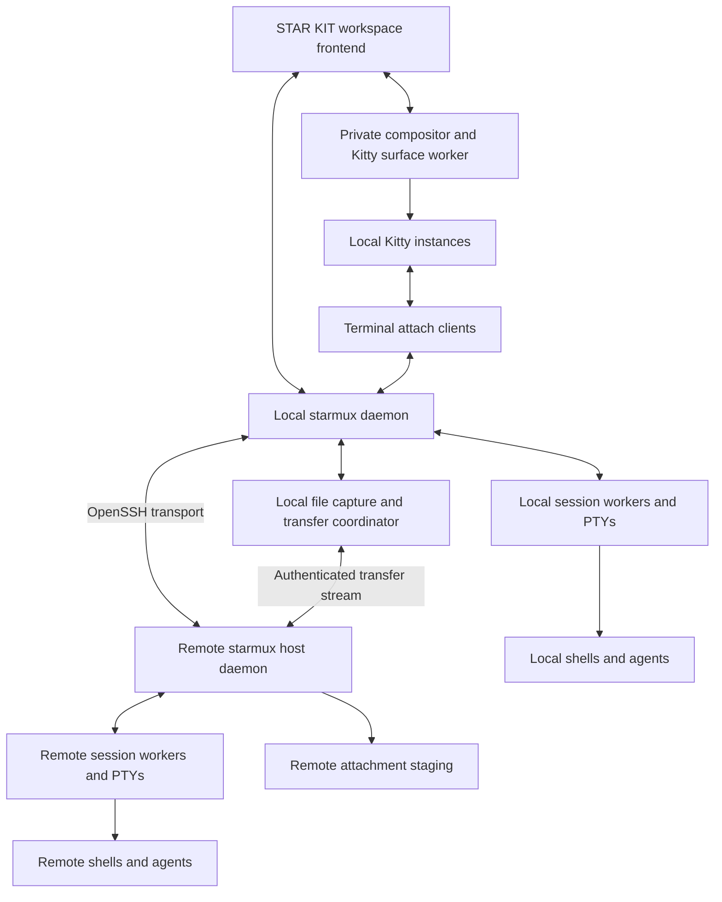

# STAR MUX architecture and implementation plan

Build an agent workspace using STAR/KIT for presentation and actual Kitty instances for terminals. Agent sessions must persist independently of the visible workspace. Dragging a desktop file onto a remote agent must transfer the file and deliver a reference or attachment that the agent can use.

The implementation begins with a narrow integration milestone. Broader workflow features follow only after embedding, input, SSH persistence, and remote attachments work together.

## Working demo status

The [Linux demo](demo.md) implements the inside-Kitty path using a private compositor and isolated tmux sessions. A real desktop drop into an existing Codex 0.162.1 conversation over authenticated loopback SSH has passed, including image understanding, a Unicode filename, presenter death and reconnect. The production worker architecture, standalone comparison, broader input matrix and release hardening remain planned below.

## Requirements and initial scope

App shelf is the preferred visual direction: project tabs across the top, Agent / Terminals / Apps within the project, and a larger app shelf beneath the active agent or terminal. The shelf opens the project’s virtual desktop for the app under development and supporting apps. Keep the grid, single borders, theme handling and explicit terminal splits. Other layout studies remain available for comparison; the installed application now implements the App Shelf interaction baseline.

The project is the workspace container. It owns its host and working directory, agent configuration and conversation, terminal sessions, app launch command and virtual app desktop. Switching projects restores their selected space and app windows without stopping their processes. Within a project, Agent, Terminals and Apps are distinct spaces. Keep additional shells in terminal tabs; only an explicit split shows multiple terminals. Provide an optional agent companion beside the app desktop. The current HTML study offers ten layouts for this shared workflow: Project desk, Project tabs, Side studio, Project tree, Compact rail, Bottom deck, Project ribbon, Project dossier, App shelf and Vertical studio. Its gallery supports comparing and keeping directions. The installed application now uses this project model; the previous two-pane experiment is retained only as development history.

Preserve Blueprint’s canvas grid with single borders across layouts, with theme selection independent of project state. The app space holds the application under development plus supporting apps in movable, focusable windows. A saved project app command provides the primary Run app action; a launcher adds other commands with a host-owned working directory. Use STAR/SCREEN’s private-compositor approach: for remote graphical apps, compositor and app run remotely and frames/input cross SSH. Ordinary remote agent terminals continue to use local Kitty. The design allows supporting apps to target the project host, this computer, or another SSH host. The production model therefore needs explicit app-to-host surface ownership and host-specific file delivery even within one project desktop; it cannot assume every window shares one compositor or filesystem.

Reconnect should attach to existing app processes, with input capture released on Ctrl+Esc, project switch or space switch. Clipboard and desktop drops need explicit host-aware transfer rather than local path insertion. Project identity must remain stable across pane changes, host reconnects and app launches. The HTML reference remains simulated. The live Rust application uses actual Kitty, tmux and persistent local/SSH app workers. See `app-shelf.md` and `../target/app-shelf-proof/result.json` for implementation and acceptance evidence; T28/T29 retain the remaining advanced split and GUI clipboard/drop acceptance cases.

The user requirements are a Herdr-like workspace, STAR/KIT integration, embedded Kitty, better agent management, advanced graphics, and reliable drag and drop into agent harnesses over SSH, particularly Codex.

Initial scope is Linux with Wayland, a local workspace client, and Linux remote hosts reachable through the user's OpenSSH configuration. Support local and remote sessions in the same workspace. Remote hosts need no graphical display server: Kitty and the graphical workspace run on the client machine; remote agents run behind remote session workers.

The first supported harness is Codex, plus a plain shell for terminal correctness. A second harness follows through the same adapter boundary. Keep generic terminal support usable when lifecycle events or native attachment delivery are unavailable.

Defer macOS embedding, Windows, a plugin marketplace, multi-user collaboration, transparent migration of live processes between hosts, and automatic task delegation. Keep process and presentation boundaries suitable for later frontends. Automatic prompt submission and automatic approval of agent actions are outside the initial behavior.

## Existing foundations

| Foundation | Verified source behavior | Consequence for STAR/MUX |
| --- | --- | --- |
| Herdr | Background terminal ownership, session restore, agent state, CLI and socket automation | Study runtime boundaries and event semantics; avoid reproducing its UI before the new embedding path works |
| STAR/KIT | Scene and cell presentation, themes, responsive panes, tiny-skia and cosmic-text rendering, persistent controllers, live canvas frames | Reuse the public presentation APIs and keep domain state in STAR/MUX |
| STAR/SCREEN | Smithay Linux compositor, GLES rendering, borderless Kitty launch, live canvas presentation and embedded input | Prototype with this implementation, then extract a small reusable compositor boundary if appropriate |
| STAR/KIT SSH file bridge | Bounded transfer over existing SSH TTY, local file capabilities, desktop drop integration | Reuse the transfer concepts and public APIs where applicable; implement agent-specific file staging and delivery |
| Kitty | Real terminal rendering and socket remote control | Keep Kitty as a process and surface; investigate a narrow control channel rather than assuming a terminal widget API |

Local source baselines inspected on 2026-10-23:

- STAR/KIT commit `7c4e223fb8e3db1df7e2f25348d2f83cf1d1c8a1`.
- STAR/SCREEN commit `919be6768871c74ee8b0a3c13f2dfbe75aed5909`.

STAR/KIT's current live-frame implementation limits a transport to eight stream identities and 256 MiB, with up to 128 MiB per frame. Start with one compositor atlas for visible panes, rather than assuming one stream per agent scales without limit. Hidden agents remain live without continuous frame delivery.

These are source capabilities, not proof that STAR/MUX's combined path already works. In particular, STAR/SCREEN's window move and resize gestures do not establish that external desktop file drops reach embedded Kitty or a remote harness.

## Presentation decision

Compare two frontends using the same application model and Kitty surface backend.

| Approach | Integration | Questions the spike must answer |
| --- | --- | --- |
| Workspace inside an outer Kitty | STAR/KIT pixel scenes and compositor frames use Kitty graphics | Can outer desktop drops be captured and routed across nested surfaces? Are key phases, selection, clipboard, image sharpness and latency acceptable? |
| Standalone Wayland window | A native window presents the workspace and private compositor surfaces | What STAR/KIT presenter work is required? Can GPU surfaces remain on the GPU? Does native input and drop handling justify the extra presenter work? |

Begin the inside-Kitty spike using existing STAR/SCREEN machinery because it has the shortest demonstrated source path. Build only enough of the standalone path to measure the important differences. Neither option is selected by this plan. Do not replace actual Kitty with another terminal engine to make the spike easier without revisiting the requirement.

Use a private nested compositor to host Kitty surfaces. Do not depend on desktop window reparenting. Preserve the outer desktop's normal window management. Run Kitty locally even when its agent is remote; sending remote PTY traffic is preferable to continuously streaming a remote graphical desktop for the initial product.

Record an architecture decision after the comparison. If both options fail mandatory behavior, stop feature expansion, record the failing cases, and revise the embedding approach.

## Runtime architecture



The daemon owns projects, tasks, host connections, routing, and durable metadata. The frontend owns visible interaction state. Session workers own agent PTYs; a terminal attach client forwards ordered bytes and resize events to a local Kitty. The compositor and Kitty are replaceable views of those sessions.

Remote workers run under a host daemon that does not die when an SSH channel closes. Start and reconnect through OpenSSH using the configured host alias, agent, jump hosts, and authentication. Avoid constructing remote commands from interpolated user strings; use a fixed helper command and structured arguments. Negotiate protocol versions and capabilities before attaching.

Separate latency-sensitive terminal input from bulk file transfer with bounded queues and scheduling. Kitty/control responses and agent output must not get lost when a file transfer saturates the link. Transport framing must never leak into the terminal byte stream.

### Terminal state and reconstruction

Daemon-owned PTYs preserve processes, but a replacement Kitty also needs terminal state. Kitty owns scrollback, selections, images, and modes while it lives. The session layer therefore needs an explicit strategy for reconstructing a terminal after Kitty or the compositor is lost.

The spike compares retaining a detached Kitty surface worker with a bounded terminal state engine and snapshot/replay. A state engine, if selected, supports reconstruction and automation; actual display still uses Kitty. Do not replay arbitrary historical terminal bytes blindly: OSC commands, clipboard operations, notifications, and queries may cause side effects or produce obsolete responses. Define a safe restoration contract covering alternate screen, cursor, colors, Unicode, resize, and graphics.

Only one attachment controls terminal input and size initially; additional views are read-only. Use attachment leases and generation numbers so stale clients cannot send input or resize a new attachment. Use explicit ownership transfer rather than races between multiple terminal sizes.

Kitty graphics require their own compatibility tests across the relay. File and shared-memory image references belong to the terminal's machine; a remote process cannot give local Kitty an arbitrary remote filesystem path. Support inline image transmission first, then add validated asset transfer and reference rewriting where needed. Do not advertise complete Kitty graphics compatibility before exercising this boundary.

### Persistence guarantees

| Failure | Required initial behavior |
| --- | --- |
| Workspace frontend closes or crashes | Local and remote agent processes continue; reconnect restores the visible layout |
| SSH connection drops | Remote host daemon and agent PTYs continue; reconnect reattaches to the same session IDs |
| One Kitty crashes | Other panes continue; affected agent PTY remains live; replacement view follows the selected reconstruction contract |
| Compositor crashes | Session workers continue; recover the display worker without restarting agents |
| Local coordinator restarts | Remote agents continue; reconnect to remote host IDs. Local worker survival is established by the selected process supervision design |
| Host daemon or session worker crashes | Mark lost sessions accurately; restore metadata and offer supported harness resume |
| Host reboots | Restore layout and saved session references; original processes have ended |

Use a transactional metadata store, initially SQLite, with schema migrations and crash-safe session updates. Keep high-volume terminal output and transferred files outside the metadata database with explicit quotas. Store opaque native harness session references separately from terminal IDs. Do not assume an interrupted tool call can be safely executed again after a restart.

## Agent and task model

Use stable IDs for host, project, worktree, task, agent run, terminal session, pane, attachment, and transfer. A pane references a terminal; a terminal belongs to a host; an agent run references its harness and native session. Tasks may have multiple runs and dependencies. Replacing a pane must not change task identity.

Keep process health, connection health, and agent lifecycle separate. Lifecycle states are `unknown`, `idle`, `working`, `needs_input`, `completed`, `failed`, and `stopped`. A silent terminal is not proof that a task completed. A reconnecting host is not proof that an agent stopped.

Adapters report event source, sequence, observation time, native session identity, capability set, and lifecycle confidence. Prefer authoritative structured events for the transitions they cover. Use output heuristics only as a labeled fallback, with stale observations returning to unknown. Reject stale or duplicate state updates. A process exit and a declared task completion are different events.

The workspace provides a project list, tiled or tabbed terminal area, and attention queue. Attention items link to the originating agent and include questions, approval requests, failures, and completed work. Dismissal is recorded; duplicate notifications coalesce. The task view shows ownership, dependencies, and artifacts. A diff view supports review before adopting worktree changes.

Create worktrees explicitly, detect an existing dirty directory, and preserve uncommitted work. Task dependencies can be recorded and watched before automatic scheduling is introduced. File delivery, prompt submission, task dispatch, and tool approval remain distinct operations.

## Drag and drop and remote attachments

The workspace captures a desktop drop before terminal text insertion. It resolves the pane under the drop and freezes that pane's host, session, and generation for the transfer. A later focus change must not redirect the file.

```text
Desktop file offer
  -> bounded local capture
  -> transfer to the selected session host
  -> private staging and verified commit
  -> harness attachment or usable remote path
  -> editable prompt
```

Use the same pipeline for a file picker and clipboard images. Dragging within the local workspace may supply an existing host asset reference and avoid a second upload. Cross-host references require a real transfer. A local path alone is insufficient for a remote agent.

### Transfer lifecycle

1. Capture offered files or URI permissions locally. Include clipboard images and temporary screenshot offers whose backing source may disappear.
2. Allocate a transfer ID and freeze destination identity. Show file names, destination host and agent, byte progress, cancellation, and errors.
3. Stream bounded chunks with backpressure into a private per-session directory on the destination. Default desktop drops to Copy.
4. Validate manifest entries, lengths and digests, then atomically commit complete files. Unfinished uploads are never exposed as ready attachments.
5. Deliver through the selected harness adapter. Emit ready status only after transfer and adapter acceptance; where the harness offers no acknowledgement, show delivery as unconfirmed until verified.
6. Retain files while referenced by a live or resumable conversation. Cleanup uses references and retention rules; never remove a file merely because a pane was closed.

On reconnect, query transfer state by ID. Resume verified chunks if implemented; otherwise restart the partial upload explicitly without duplicate attachment delivery. Deduplicate committed attachment delivery independently from upload retry. Never submit the user's prompt as a side effect of a drop.

Validate file names and manifest paths against traversal, avoid overwrites, and define symlink behavior before enabling directory drops. Preserve symlinks as links or reject them explicitly; do not silently follow links outside the offered tree. Apply byte, file-count, directory-depth, disk-space and time limits with actionable errors. External URI offers must not become arbitrary remote requests to read local paths.

Place staging within a location the agent's filesystem permissions and sandbox can read. If an agent runs in a container or a distinct mount namespace, negotiate a mapped location or fail clearly. A completed SSH upload alone does not establish that the harness can access it.

### Harness delivery

Codex is the first adapter. Official documentation establishes image inputs through the composer and startup `--image`; it does not establish that STAR/MUX can attach an image to every already-running TUI version. The spike must establish that exact behavior with the installed version.

Prefer a supported structured attachment interface where available. For a terminal harness, deliver the completed remote path using the harness's tested paste/attachment behavior and preserve bracketed paste boundaries. Keep shell escaping separate from composer text handling. Never inject a shell command into an active agent prompt.

For an image, acceptance means the harness receives image content and can answer a question about it. A filename displayed in a composer is insufficient. For ordinary files, acceptance means the agent can read the expected bytes at the remote reference. Record which harness versions and file types pass. A new-session image flag is a useful baseline but does not replace the existing-session requirement.

If the first Codex attachment approach fails, investigate a native protocol adapter before expanding the UI. Preserve actual Kitty terminals for interactive harness use even if structured agent control becomes an optional delivery path.

## Graphics and input

Keep the three rendering responsibilities explicit: Kitty renders terminal content; the compositor arranges Kitty surfaces; STAR/KIT draws workspace chrome, task views, diffs, diagrams and artifact previews. STAR/KIT's current native scene renderer is CPU-based tiny-skia and cosmic-text. GLES composition does not make the entire path GPU-resident or eliminate readback and image-upload costs.

Use damage tracking, bounded queues, cached UI regions and latest-frame coalescing. Retain the current view when no damage occurs. Never drop ordered terminal bytes or encoded video packets to coalesce frames. Keep image previews optional and avoid linking media codecs merely for a graphical task view.

The presentation spike measures direct Kitty as a baseline and the embedded path at fixed font, resolution, scale and workload. Include 1080p and 4K, two active panes and a visible eight-pane layout, fractional scaling, Unicode, images, and rapidly updating output. Record memory, CPU, GPU load, changed-pixel bytes, terminal input latency, frame delivery latency and final display latency separately.

Provisional local targets are p95 input-to-visible-update below 50 ms for two panes at 1080p and below 100 ms for eight panes, plus idle CPU below 2 percent of one core after settling. These are proposed targets to validate on named hardware in the spike, not measured results. Publish the result and revised budget if the target is impractical. Under saturation, input and file-transfer progress must remain responsive with bounded memory.

Do not promise 60 Hz until final displayed frames are measured. If CPU rasterization or readback dominates, prototype a GPU presenter behind the same scene model and measure it before choosing wgpu or another backend. Preserve a cell presentation for metadata and diagnostics without implying that it provides embedded graphical terminals.

Input checks cover press/repeat/release, Ctrl+C, multiline paste, terminal query replies, wheel scrolling, text selection, clipboard, IME composition, focus loss and resize. Retain STAR/KIT's Ctrl+Esc escape from embedded input where available and provide a visible standalone equivalent. File drops and prompt text must target the correct pane even while overlays are open. Modal focus cannot leave keys held inside a Kitty surface.

## Interfaces and packaging

Start with logical modules; split crates when the first milestone establishes stable boundaries. Proposed modules are `model`, `runtime`, `session`, `host`, `protocol`, `terminal`, `compositor`, `attachments`, `adapters`, `ui`, and `storage`.

Proposed executables are `starmux`, a daemon mode, a fixed remote helper mode, and a terminal attach mode. Keep their transport implementations shared. Initial commands cover launch, list sessions, attach, detach, inspect, and stop a selected session. An explicit stop is distinct from closing the workspace.

Use versioned request and response schemas, bounded payloads, request IDs, structured errors, sequence numbers, reconnect cursors, and cancellation. Event consumers that fall behind receive a resnapshot instruction. Mutating retryable operations need idempotency keys. Bind local sockets in private runtime directories and avoid a public TCP listener by default.

Expose narrow private Kitty control sockets only to the components that need them. Agent control is session-scoped; terminal output is untrusted data and cannot grant a new capability. External action requests remain subject to the user's harness controls.

Pin STAR/KIT by immutable revision after checking its source manifest and APIs; the inspected README's release discussion differs from its manifest version. The initial build may use a documented local override, but a distributable build must not require a sibling checkout. Extract shared compositor code through a deliberate change to the owning repository rather than making STAR/MUX depend on STAR/SCREEN's private UI and recording code. Review actual source licenses and required notices before copying or distributing code; older Herdr forks may differ from current upstream.

Use official distribution packages or Nix for build dependencies. No AUR dependency is assumed. Keep codec, audio, GPU, and desktop requirements explicit, with actionable startup diagnostics. Runtime logs must redact secrets and avoid full prompt or attachment content by default.

## Milestones and gates

| Milestone | Deliverable | Exit gate |
| --- | --- | --- |
| M0 Integration proof | Minimal workspace, two real Kitty panes, remote Codex, attachment transfer, persistent sessions, presentation comparison | A real desktop screenshot reaches an existing remote Codex conversation; correct pane receives it; disconnect and frontend loss preserve the same remote process; presentation decision recorded |
| M1 Runtime foundation | Stable IDs, local and remote workers, protocol, storage, attachment leases, session CLI | Terminal correctness and declared failure guarantees pass; migrations and reconnect are exercised |
| M2 Daily agent workspace | Projects, worktrees, pane layout, Codex adapter, attention queue, session resume, shell fallback | A user can run and review multiple local and remote agents with accurate connection and lifecycle states |
| M3 Files and graphical review | Full transfer lifecycle, file picker, clipboard images, directories, task and artifact views, diff review | Remote delivery matrix and attachment retention tests pass; input remains responsive under transfer load |
| M4 Hardening and release | Packaging, diagnostics, documented compatibility, sustained load and fault tests | Clean-machine install and scripted desktop acceptance pass on the selected reference environment |

M0 is a deliberately narrow vertical slice of later milestones. Its transport, attachment and adapter code can be experimental; do not implement directories, broad harness coverage or elaborate task UI before its gate passes. Productize that slice in M1 through M3.

## Validation and release evidence

Use unit tests for lifecycle reduction, routing, generations, transfer manifests, retry behavior and layout. Use process-level integration tests for PTY I/O, resize, query replies, SSH disconnect, worker death, metadata recovery and protocol skew. Use real Kitty and Wayland desktop tests for embedding, IME, selection, clipboard and file offers. Mock file events alone cannot satisfy drag and drop acceptance.

Run remote attachment tests against an existing interactive Codex session using user-provided authentication or available credentials. Synthetic adapters cover CI without model calls; they do not establish real Codex compatibility. Avoid persisting model credentials in fixtures. If remote access is unavailable, record that gate as pending rather than substituting a local-only pass.

The mandatory matrix includes PNG and JPEG screenshots, ordinary documents, multiple files, directories and symlinks once supported, spaces and Unicode, identical basenames, temporary screenshots, large files, read-only destinations, exhausted disk space, two different remote hosts, SSH interruption mid-upload, cancellation, focus changes, pane closure, reconnect, and agent sandbox restrictions. Test generated remote artifact export separately from inbound attachments.

For persistence, record PID and session ID before and after detach, frontend kill, compositor kill and SSH disconnect. Check for duplicate workers and orphan cleanup. Run a two-hour soak with eight agents, repeated reconnects and concurrent uploads. Capture peak memory and queue limits, not only average utilization.

Store reproducible commands, versions, hardware, pass/fail results and known limits with each milestone. The release checklist distinguishes implemented behavior, automated checks, real desktop acceptance and unresolved platform coverage. No application tests are required merely to save this planning document; implementation tests belong to the tasks below.

## First execution sequence

Start with T01 and T02 in the task backlog. Then implement the minimum session relay, embedding and attachment path needed for T03 through T07. Record the presentation decision in T08 before the broader runtime and workflow phases. Each task has a concrete deliverable and an acceptance condition in [TASKS.md](../TASKS.md).

## References

- [Herdr upstream](https://github.com/herdrdev/herdr), [session persistence](https://herdr.dev/docs/session-state/), [socket API](https://herdr.dev/docs/socket-api/), and [agent integrations](https://herdr.dev/docs/integrations/).
- [Kitty remote control](https://sw.kovidgoyal.net/kitty/remote-control/).
- [Official Codex image input documentation](https://learn.chatgpt.com/docs/image-inputs?surface=cli).
- [STAR/KIT rendering](../../starkit/docs/terminal-graphics.md), [live canvas implementation](../../starkit/src/terminal_graphics/live_canvas.rs), [drop bridge](../../starkit/src/terminal_graphics/drop_bridge.rs), and [existing SSH shell integration](../../starkit/integrations/kitty/README.md).
- [STAR/SCREEN compositor](../../starscreen/src/compositor/mod.rs), [Linux renderer](../../starscreen/src/compositor/linux.rs), [embedded input handlers](../../starscreen/src/compositor/handlers.rs), and [Kitty launch implementation](../../starscreen/src/ui.rs).
